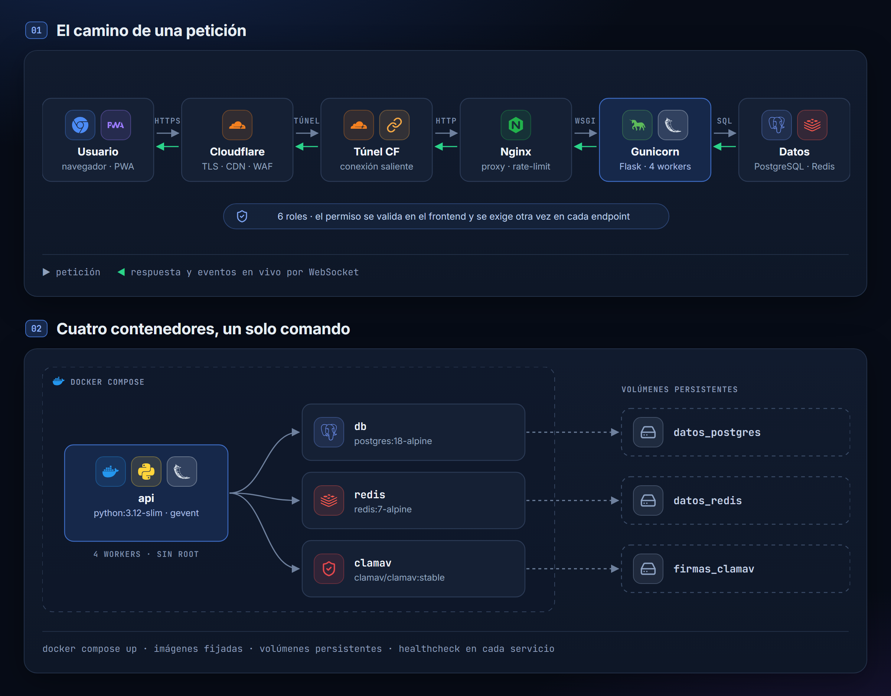
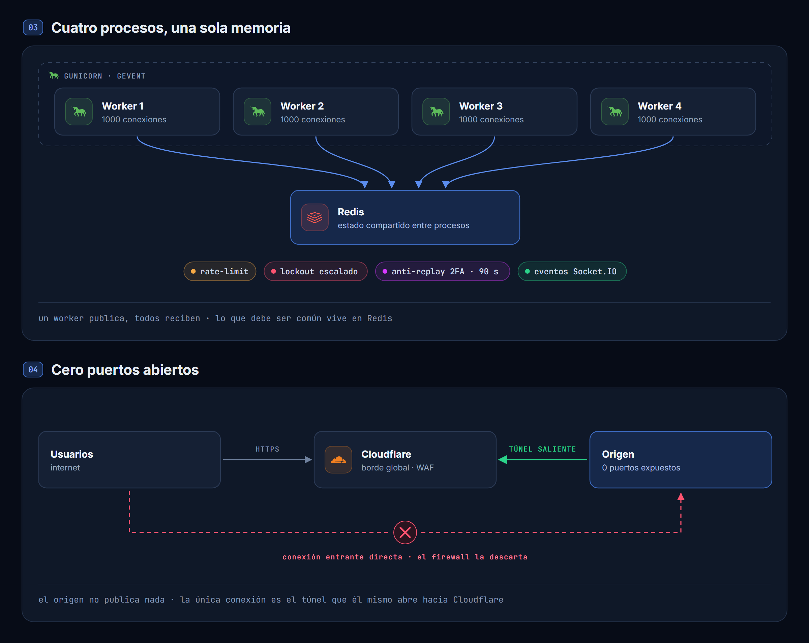
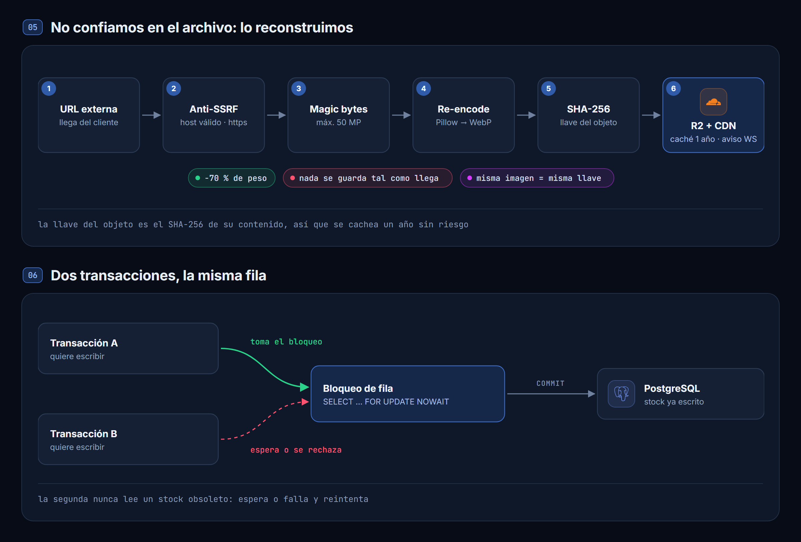
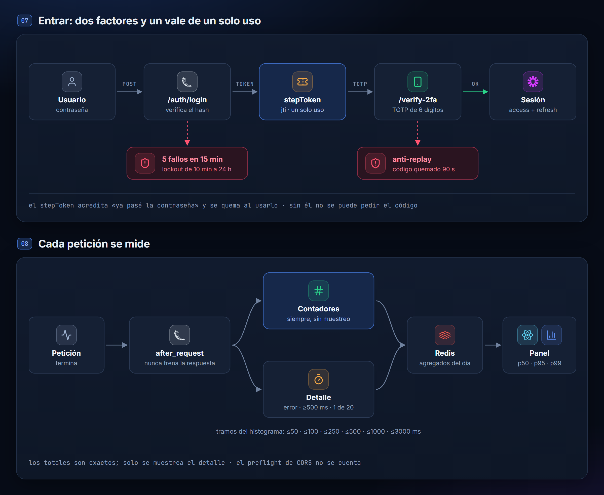
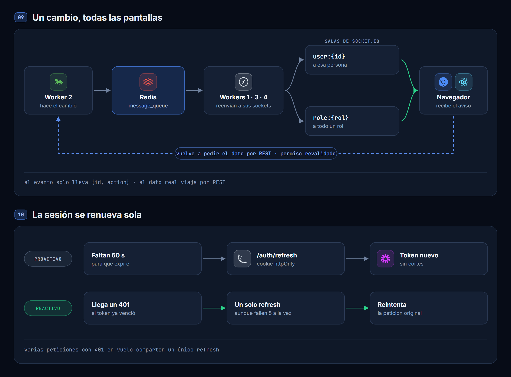

# Sistema de Nóminas — Backend (Skilled ERP)

API JSON en **Flask** que sirve al SPA Skilled ERP (React) para nóminas, empleados, inventario, herramientas y reportes. Despliegue **API-only**: este repo expone `/api/*` y el canal de Socket.IO; el frontend vive en el repo `plantilla-frontend/` y se hostea en Vercel.

---

## Cómo funciona

### El camino de una petición y los contenedores



Todo entra por Cloudflare, baja por el túnel, pasa por Nginx y termina en Gunicorn. En local ese mismo camino se levanta con `docker compose up`: api, PostgreSQL, Redis y ClamAV, cada uno con su volumen.

### Cuatro workers y un origen sin puertos abiertos



Los 4 workers de gevent son procesos distintos, así que lo que debe ser común —rate-limit, lockout, anti-replay de 2FA, eventos de Socket.IO— vive en Redis. El origen no publica puertos: la única conexión es el túnel saliente.

### Archivos que se reconstruyen y escrituras que se serializan



Una imagen externa se valida (anti-SSRF, magic bytes), se reescribe a WebP y se sube a R2 con el SHA-256 de su contenido como llave. En inventario, `SELECT … FOR UPDATE` evita que dos movimientos pisen el mismo stock.

### Login con 2FA y medición de cada petición



La contraseña devuelve un `stepToken` de un solo uso que es lo único que permite pedir el TOTP. Cada respuesta suma contadores en Redis; de ahí salen los p50/p95/p99 del panel de sistemas.

### Realtime y renovación de sesión



Un cambio se publica en Redis y cada worker lo reenvía a sus salas `user:{id}` o `role:{rol}`; el navegador vuelve a pedir el dato por REST, donde se revalida el permiso. La sesión se renueva sola 60 s antes de expirar.

---

## Stack

- **API**: Flask 3 + SQLAlchemy 2 + PyJWT + Flask-Limiter + Flask-Talisman
- **DB**: PostgreSQL (psycopg v3) con Alembic
- **Redis**: rate-limit, lockout, anti-replay de TOTP y `message_queue` de Socket.IO
- **Realtime**: Socket.IO — `gevent` en prod, `threading` en dev
- **Archivos**: Cloudflare R2 (público y privado) + ClamAV
- **Documentos**: pandas + openpyxl (Excel), xhtml2pdf + reportlab (PDF)
- **Despliegue**: Gunicorn (4 workers gevent) → Nginx → Cloudflare Tunnel

Por qué cada pieza: [`docs/STACK_Y_ALTERNATIVAS.md`](./docs/STACK_Y_ALTERNATIVAS.md).

---

## Arranque rápido

```bash
cp .env.example .env           # rellenar SECRET_KEY, DATABASE_URL, REDIS_URL…
docker compose up --build      # api en http://localhost:5000
pytest tests/                  # correr tras cualquier cambio
```

Requisitos, venv, variables del `.env`, estructura del repo y comandos: [`docs/INSTALACION.md`](./docs/INSTALACION.md).

---

## Qué cubre

Empleados, nómina y préstamos, horas, proyectos M:N, inventario, herramientas, panel de sistemas, carga masiva, reportes PDF/Excel y notificaciones en tiempo real, con 7 roles. Detalle de cada módulo, roles y notificaciones: [`docs/MODULOS_Y_ROLES.md`](./docs/MODULOS_Y_ROLES.md). Los 216 endpoints: [`docs/API_REFERENCE.md`](./docs/API_REFERENCE.md).

---

## Seguridad

JWT con refresh rotativo, 2FA en dos pasos, lockout escalado, whitelist de campos por rol, archivos validados por magic bytes y escaneados con ClamAV, y origen sin puertos expuestos. Auditoría del 2026-05-23: score 5.8 → 8.4/10. Controles vigentes, pendientes operativos e higiene: [`docs/SEGURIDAD.md`](./docs/SEGURIDAD.md).

---

## Documentación

| Doc | Contenido |
|---|---|
| `INSTALACION.md` | Requisitos, Docker, venv, `.env`, estructura del repo y comandos |
| `PRODUCCION.md` | Gunicorn, Nginx, Vercel y checklist post-deploy |
| `MODULOS_Y_ROLES.md` | Qué cubre cada módulo, roles y notificaciones |
| `RESUMEN_SISTEMA.md` | Resumen ejecutivo de una página |
| `ARQUITECTURA.md` | Mapa del código: factory, blueprints, realtime, utils |
| `STACK_Y_ALTERNATIVAS.md` | Tecnologías y comparativa contra Supabase |
| `API_REFERENCE.md` | Los 216 endpoints, agrupados por blueprint |
| `MODELOS_BD.md` | Tablas, columnas y relaciones |
| `SEGURIDAD.md` | Auditoría, controles vigentes, pendientes e higiene |
| `DOCKER.md` / `DIA_A_DIA.md` / `PENDIENTE_PRODUCCION.md` | Contenedores en local y en el VPS |
| `WEBSOCKETS_Y_DEPLOY.md` / `DEPLOY_GEVENT.md` / `MIGRACION_EVENTLET_A_GEVENT.md` | Socket.IO en producción y gevent |
| `FIX_WEBSOCKET_TOKEN_EXPIRADO.md` / `FIX_WEBSOCKET_RECONEXION_MATUTINA.md` | Fixes de reconexión de WS |
| `MIGRACION_ARCHIVOS_A_R2.md` / `ANTIVIRUS_CLAMAV.md` | R2 y escaneo de subidas |
| `MIGRACION_USERESOURCE_REALTIME.md` | Migración del módulo de realtime |
| `MANUAL_USO_PRENOMINA_PRESTAMOS_INBURSA.md` | Manual funcional de prenómina y préstamos |
| `NOTAS_TRABAJADOR.md` / `ORDENAMIENTO_LISTADOS.md` / `PROYECTOS_DERIVACION_M2M.md` | Notas, orden por columna y proyectos M:N |
| `PLAN_ASIGNACION_POR_PROYECTO.md` / `PLAN_MATERIAL_POR_PROYECTO.md` | Planes por proyecto |
| `REFACTOR_ARCHIVOS_GRANDES.md` | Refactor a sub-paquetes |

---

## Licencia

MIT. El texto completo está en [`LICENSE`](./LICENSE).
